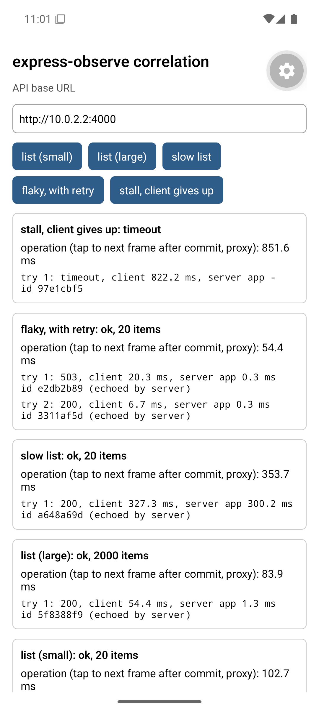

# Android emulator run — 2026-10-14

First run of the Expo app on an Android client. One session of the five scenarios, after the safe-area fix below.



## Setup

```text
host:           Windows 11, Intel i5-12500, WHPX acceleration
emulator:       Android Emulator 36.2.12, AVD Pixel 6 profile, Android 15 (API 35, google_apis, x86_64)
client:         Expo Go 57.0.9, Expo SDK 57.0.28, React Native 0.86.3, Hermes
server:         examples/react-native-correlation/server.js on the host, 127.0.0.1:4000, trustIncoming: true
app base URL:   http://10.0.2.2:4000 (the emulator's alias for the host loopback)
procedure:      buttons tapped in order through adb; Metro console and server stdout saved; join-cli.js
```

## Joined view

| Operation | Try | Client | Client ms | Server | Server ms | Header ms | Not measured by server ms |
|---|---|---|---|---|---|---|---|
| list (small) | 1 | 200 ok | 50.8 | 200 finished | 1.2 | 0.3 | 49.6 |
| list (large) | 1 | 200 ok | 54.4 | 200 finished | 2.2 | 1.3 | 52.2 |
| slow list | 1 | 200 ok | 327.3 | 200 finished | 301.1 | 300.2 | 26.2 |
| flaky, with retry | 1 | 503 http-error | 20.3 | 503 finished | 0.8 | 0.3 | 19.5 |
| flaky, with retry | 2 | 200 ok | 6.7 | 200 finished | 0.7 | 0.3 | 6.0 |
| stall, client gives up | 1 | timeout | 822.2 | interrupted, no status | 800.0 | - | - |

All six attempts matched a server record by the request ID the client sent. The abandoned request matched an `interrupted` record with `status: null`.

## Client-side detail

| Operation | responseMs | clientAttemptMs | Body bytes | operationMs (proxy) |
|---|---|---|---|---|
| list (small) | 42.9 | 50.8 | 1,313 | 102.7 |
| list (large) | 32.7 | 54.4 | 137,797 | 83.9 |
| slow list | 325.6 | 327.3 | 1,313 | 353.7 |
| flaky, with retry (2 tries) | 19.3, 5.4 | 20.3, 6.7 | 35, 1,313 | 54.4 |
| stall, client gives up | - | 822.2 | - | 851.6 |

## What the run shows

- **Most of a fast request's time is outside the server.** For the small and large lists the server measured 1–2 ms and the client 50–55 ms. The records cannot split that remainder; on this setup it includes connection setup, the emulator's network translation, the React Native networking bridge and JSON parsing.
- **Body handling is visible on the client only.** For the 138 KB list, about 22 ms passed between `fetch()` resolving and the parsed result. The server's numbers do not change with payload size here.
- **Server-Timing explains the slow case without any log.** The client saw `server app 300.2 ms` directly in the header for the slow list.
- **The abandoned request is still traceable.** The client timed out at 822 ms (its 800 ms timer fired late on a busy JS thread); the server recorded the disconnect at 800 ms with no status.
- **The first tap of a session is slower.** Connection setup and warm-up land on whichever request comes first.

## Limits

- An emulator on the same machine is not a phone: no radio network, a desktop CPU, and `10.0.2.2` is the emulator's address translation, not a real network path.
- One session. These are observations, not benchmarks.
- Whether React Native's `fetch` resolves before or after the body cannot be told from this data: on loopback the transfer is too fast to separate.
- `operationMs` is a proxy that ends at the first frame after React committed the result.

## Found during this run

On React Native 0.86, `SafeAreaView` from `react-native` logs a deprecation warning, and on Android it did not keep the title clear of the status bar. The app now uses `react-native-safe-area-context` (5.7, the version `expo install` selects for SDK 57); after the change the warning is gone and the layout starts below the status bar.
